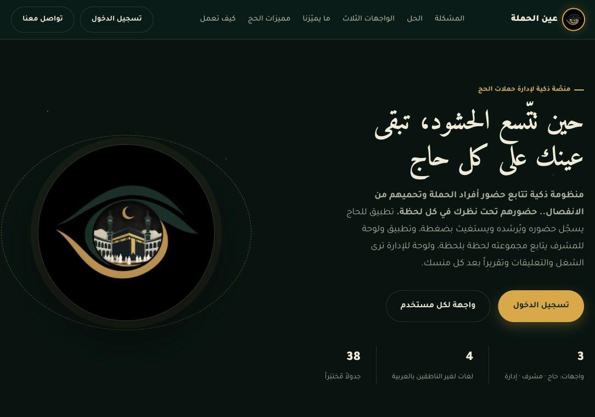
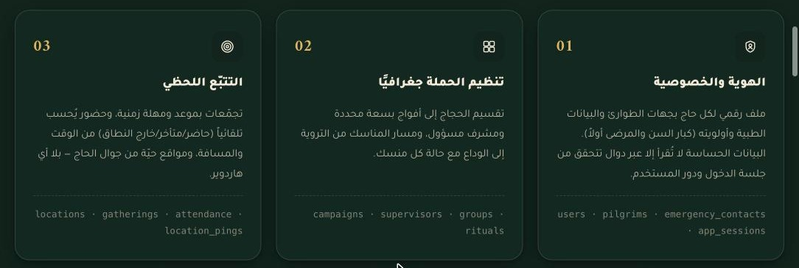
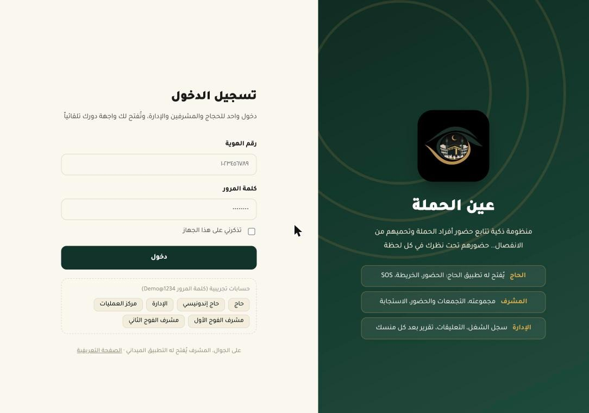

<div align="center">


# Ain Al-Hamla · عين الحملة

**A smart attendance & safety platform that keeps every Hajj pilgrim in sight — and keeps groups from getting separated.**

منظومة ذكية تتابع حضور أفراد حملة الحج وتحميهم من الانفصال.. حضورهم تحت نظرك في كل لحظة.

[](https://ain-alhamla2.netlify.app)
[](https://ain-alhamla2.netlify.app/download/ain-alhamla.apk)
[](https://dbdiagram.io/d/6aab2b53af7c3b0bd1fc3b78)


[English](#-overview) · [العربية](#-نظرة-عامة)



</div>

---

## 📌 Overview

During Hajj, a single campaign moves tens of thousands of people between the holy sites. Manual head-counts and scattered radios leave a dangerous gap between the moment a pilgrim goes missing and the moment anyone notices. **Ain Al-Hamla closes that gap** — using only the pilgrim's phone, with no extra hardware.

It is a full-stack system built as a graduation project in **Computer Programming & Web Development** at the College of Digital Technology (TVTC), Saudi Arabia.

| Interface | Role | Where |
|---|---|---|
| 📱 Pilgrim app | `PILGRIM` | Flutter (Android + Web): home, live map, schedule, alerts, profile, "My Hajj" |
| 🧭 Supervisor app | `SUPERVISOR` | Same app + dashboard scoped to their group |
| 🖥️ Operations dashboard | `ADMIN` / `OPERATIONS_CENTER` | Full web control panel |
| 👨‍👩‍👧 Family link | no account | Temporary reassurance link — status only, never exact location |

## ✨ Key Features

**Core**
- ✅ App-based check-in at gathering points, with automatic present / late / out-of-range status
- 🗺️ Live map of the whole campaign that **works offline** (cached map tiles)
- ⏰ Automatic absence & distance alerts when deadlines or safe radii are exceeded
- 🆘 One-tap **SOS** routed to the supervisor and the nearest responders, with escalation
- 🩺 Digital medical profile, priority ranking (elderly / ill first), and emergency contacts
- 📝 Auto-generated report after every Hajj ritual (print / CSV)
- 🌍 4 languages + bilingual emergency card and ready-made phrases

**Hajj-specific intelligence**
- 📉 **Lost-risk score** per pilgrim (distance, last seen, battery, age, health, buddy distance)
- 🤝 **Buddy system** with separation alerts, and **smart meeting points** for lost pilgrims
- 🌡️ **Heat-stress** monitoring tailored to age and health
- 📍 **Sacred-site boundaries** (Arafat / Muzdalifah / Mina) with overnight-stay tracking in Mina
- 💊 Medication schedules with missed-dose alerts, and an **"Are you OK?"** check when movement stops
- 🚌 Bus readiness before departure and crowd-pulse forecasts for the best time to go

<div align="center">

</div>

## 🗄️ Database Design

The heart of the project is a carefully modelled PostgreSQL database, evolved over four versions through incremental migrations.

| Metric | Count |
|---|---:|
| Tables | **38** (13 core → +8 v2 → +4 v3 → +13 v4) |
| Relationships | 83 |
| ENUM types | 21 |
| Indexes | 106 |
| CHECK constraints | 34 |
| API functions (`app_*`) | 76 + 23 internal helpers |

**Security by design**
- **Row Level Security** is enabled on all 38 tables.
- Clients never read sensitive tables directly — every call goes through `SECURITY DEFINER` `app_*` functions that validate the session and the caller's role first.
- Only the public `anon` key ships in client code; all protection lives in RLS and the functions.

📐 [Interactive ERD on dbdiagram.io](https://dbdiagram.io/d/6aab2b53af7c3b0bd1fc3b78) · [`schema.dbml`](database/schema.dbml) · [ERD PDF](database/مخطط_ER_عين_الحملة_v4.pdf)

<details>
<summary><b>Migration order (01 → 13)</b></summary>

| File | Purpose |
|---|---|
| `01_schema.sql` | Core schema (13 tables) |
| `02_seed.sql` | Demo data |
| `03_connect_app_and_website.sql` | Sessions & login functions |
| `04_migration_v2.sql` | +8 tables (rituals, gatherings, location pings, reports…) |
| `05_seed_v2.sql` | v2 demo data |
| `06_offline_map.sql` | Offline map support |
| `07_migration_v3_features.sql` | +4 tables (buddy, meeting points, heat, crowds) |
| `08_migration_v4_hajj.sql` | +13 tables (site bounds, medications, family, messages, lost & found…) |
| `09` → `13` | Dashboard & app enhancements, fixes, alert location |

> Files that add new ENUM values are wrapped in `BEGIN; … COMMIT;` to avoid PostgreSQL error `55P04`.
</details>

## 🏗️ Architecture

```
┌──────────────────────┐      ┌──────────────────────┐
│  Flutter app         │      │  Web dashboard       │
│  (Android + Web)     │      │  HTML · CSS · JS     │
│  Pilgrim/Supervisor  │      │  Admin / Ops center  │
└──────────┬───────────┘      └──────────┬───────────┘
           │   supabase-js / supabase_flutter (RPC)   │
           └───────────────┬──────────────────────────┘
                           ▼
        ┌───────────────────────────────────────┐
        │  Supabase · PostgreSQL                │
        │  app_* functions → RLS → 38 tables    │
        └───────────────────────────────────────┘
```

## 📂 Repository Structure

```
├── database/      SQL migrations 01→13, schema.dbml, ER diagrams (PDF + erd/)
├── flutter_app/   Flutter app for pilgrims & supervisors (Android + Web)
├── website/       Landing page, dashboard/, and the built web app (app/) — Netlify-ready
└── docs/          Presentation, project card, traceability matrix, screenshots
```

## 🚀 Getting Started

**Website & dashboard**
```bash
cd website
python3 -m http.server 8080
# open http://localhost:8080/dashboard/login.html
```

**Mobile app**
```bash
cd flutter_app
flutter pub get
flutter run                    # or: flutter build apk --release
```

**Database** — run the files in `database/` in order (`01` → `13`) on a Supabase (PostgreSQL) project.

**Demo accounts** (password `Demo@1234`): Admin `1010101010` · Pilgrim `1030303030`

## ⚠️ Known Limitations

- Sacred-site boundaries are approximate, for demonstration — not the official limits.
- Supervisor message translations are entered at send time; machine translation and voice notes need an external service (`audio_url` is ready).
- Notifications appear inside the app and dashboard (20-second refresh); push notifications outside the app require Firebase Cloud Messaging.

---

<div dir="rtl">

## 📌 نظرة عامة

**عين الحملة** منظومة ذكية تتابع حضور أفراد حملة الحج وتحميهم من الانفصال، بجوال الحاج فقط ومن غير أي أجهزة إضافية.

مشروع تخرّج — برمجة الحاسب وتطوير الويب، كلية التقنية الرقمية، المؤسسة العامة للتدريب التقني والمهني.

| الرابط | |
|---|---|
| الموقع ولوحة التحكم | https://ain-alhamla2.netlify.app |
| تطبيق الحاج والمشرف (ويب) | https://ain-alhamla2.netlify.app/app/ |
| تطبيق أندرويد (APK) | [صفحة Releases](../../releases/latest) أو [تحميل مباشر](https://ain-alhamla2.netlify.app/download/ain-alhamla.apk) |
| مخطط ERD التفاعلي | https://dbdiagram.io/d/6aab2b53af7c3b0bd1fc3b78 |

### الواجهات والأدوار

| الواجهة | الدور | أين |
|---|---|---|
| الحاج | PILGRIM | التطبيق: الرئيسية، الخريطة، جدولي، التنبيهات، حسابي، «حجّي» |
| المشرف | SUPERVISOR | التطبيق + لوحة التحكم لمجموعته |
| الإدارة | ADMIN / OPERATIONS_CENTER | لوحة التحكم كاملة |
| الأهل | بدون حساب | رابط مؤقت `family.html?t=` بلا موقع دقيق |

### أبرز الوظائف

تسجيل الحضور عند نقاط التجمع، وخريطة حيّة تعمل بدون إنترنت، وتنبيه غياب وابتعاد تلقائي، وزر SOS يصل لأقرب مستجيب، وملف طبي وجهات طوارئ، وتقرير بعد كل منسك، و4 لغات.

ومميزات الحج: مؤشر خطر الضياع، نظام الرفيق، نقطة اللقاء الذكية، الإجهاد الحراري، حدود المشاعر والمبيت بمنى، الأدوية والجرعات، «أنت بخير؟»، رابط الأهل، رسائل المشرف بلغة الحاج، المفقودات، عدّاد المناسك، دليل اليوم، وتقرير نهاية الحج. التفصيل الكامل في [مصفوفة التكافؤ](docs/مصفوفة_التكافؤ.md).

### قاعدة البيانات بالأرقام

- 38 جدولاً: 13 أصلية، و8 في v2، و4 في v3، و13 في v4.
- 83 علاقة، و21 نوع ENUM، و106 فهارس، و34 قيد CHECK.
- 76 دالة `app_*` تستدعيها الواجهات، و23 دالة مساعدة داخلية، ودالة عامة للأهل `family_view`.
- Row Level Security مفعّلة على الجداول الـ38 كلها؛ الواجهات لا تقرأ الجداول الحساسة مباشرة، بل عبر دوال `app_*` بعد التحقق من الجلسة والدور.

### التشغيل محلياً

- **الموقع ولوحة التحكم:** افتحي `website` في VS Code ← Live Server ← `dashboard/login.html` (أو `python3 -m http.server 8080` داخل `website`).
- **التطبيق:** داخل `flutter_app`: `flutter pub get` ثم `flutter run` أو `flutter build apk --release`.
- **حسابات التجربة:** الإدارة `1010101010`، الحاج `1030303030`، وكلمة المرور `Demo@1234`.

### حدود صريحة

- حدود المشاعر تقريبية للعرض وليست الحدود الرسمية.
- ترجمات رسائل المشرف تُكتب عند الإرسال؛ الترجمة الآلية والتسجيل الصوتي يحتاجان خدمة خارجية (`audio_url` جاهز).
- الإشعارات تظهر داخل التطبيق ولوحة التحكم (تحديث كل 20 ثانية)؛ إشعار الجوال خارج التطبيق يحتاج ربط Firebase Cloud Messaging.
- المفتاح الموجود في الكود هو مفتاح `anon` العام فقط؛ الحماية تعتمد على RLS والدوال.

</div>

---

<div align="center">



Graduation Project · Computer Programming & Web Development · College of Digital Technology — TVTC 🇸🇦

</div>
