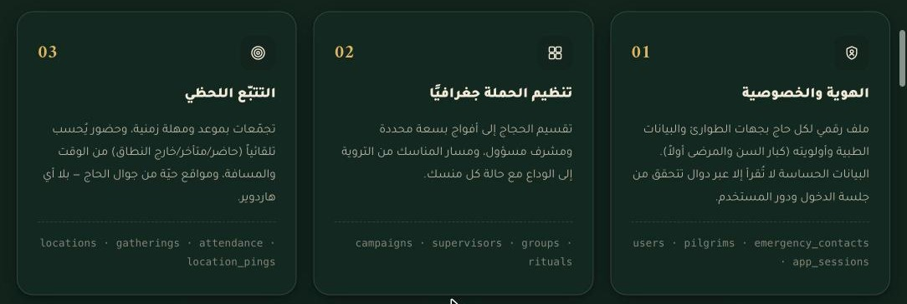
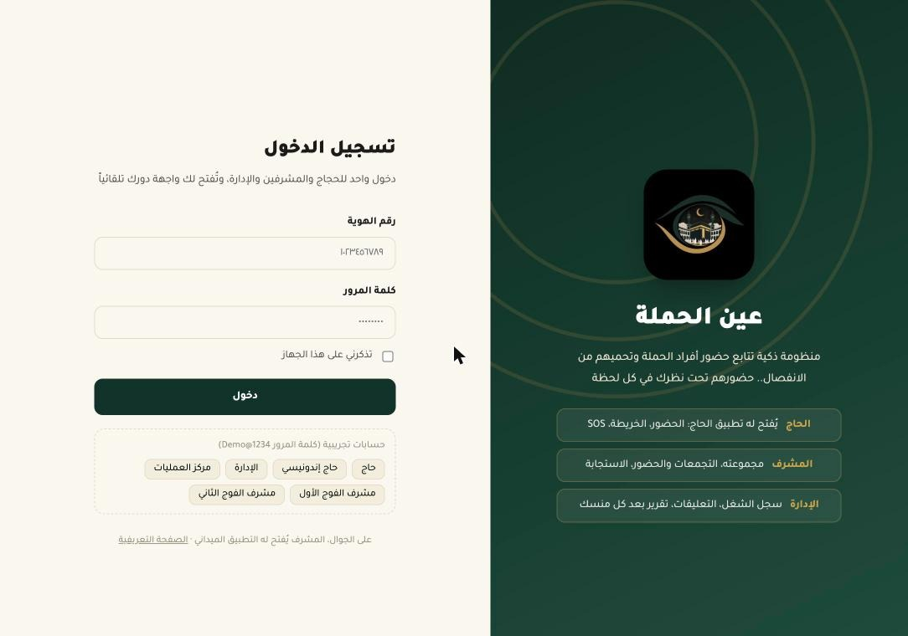

<div align="center" dir="rtl">


# عين الحملة · Ain Al-Hamla

**منظومة ذكية تتابع حضور أفراد الحملة وتحميهم من الانفصال.. حضورهم تحت نظرك في كل لحظة.**

[](https://ain-alhamla2.netlify.app)
[](https://ain-alhamla2.netlify.app/download/ain-alhamla.apk)
[](https://dbdiagram.io/d/6aab2b53af7c3b0bd1fc3b78)


[العربية](#-نظرة-عامة) · [English](#-english-summary)


</div>

<div dir="rtl">

## 📌 نظرة عامة

**عين الحملة** مشروع تخرّج في **برمجة الحاسب وتطوير الويب** — الكلية التقنية الرقمية للبنات بجدة، المؤسسة العامة للتدريب التقني والمهني، مقرر «برمج ٢٩٥»، الفصل التدريبي الأول ١٤٤٨هـ، بإشراف المدربة **مزنة العقلا**.

منظومة متكاملة من **تطبيق جوال** و**لوحة تحكم على الويب** و**قاعدة بيانات واحدة**، تساعد حملات الحج على متابعة حضور أفرادها لحظة بلحظة وحمايتهم من الانفصال، بجوال الحاج وحده ومن غير أي أجهزة أو أساور.

## 🎯 المشكلة والحل

**المشكلة:** يعتمد مشرفو الحملات على العدّ اليدوي وقوائم الورق ومجموعات واتساب لمتابعة مئات الحجاج، فيتأخر اكتشاف الغياب والفقدان في اللحظات الحرجة كصعود الحافلات ورمي الجمرات. ويفقد كثير من الحجاج — وبالأخص كبار السن وغير الناطقين بالعربية — الاتصال بحملتهم وعائلاتهم في الزحام، مع ضعف شبكات الجوال.

**الحل:** يسجّل الحاج حضوره من جواله عند نقاط التجمع ويُرسل موقعه دورياً، فيرى المشرف قائمة حضور لحظية وخريطة حيّة، ويصله تنبيه تلقائي مرتّب حسب أولوية الحاج عند الغياب أو الابتعاد أو ضغط زر الاستغاثة. والتطبيق يستمر في العمل مع ضعف الشبكة.

## 👥 واجهة لكل دور

تسجيل دخول واحد، وتُفتح الواجهة المناسبة للدور تلقائياً، والصلاحيات يتحقق منها **الخادم نفسه** وليس الواجهة فقط.

| الواجهة | الدور | أين | أهم ما فيها |
|---|---|---|---|
| 📱 الحاج | `PILGRIM` | التطبيق | تسجيل الحضور، الخريطة (تعمل بدون إنترنت)، SOS و«أنا تائه»، الملف الطبي وجهات الطوارئ، «حجّي»، «عائلتي ورفقتي» |
| 🧭 المشرف الميداني | `SUPERVISOR` | التطبيق + لوحة مجموعته (14 صفحة) | مجموعته فقط مرتّبة بالأولوية، فتح التجمعات وإغلاقها، تسجيل يدوي، الاستجابة للتنبيهات، إنهاء المنسك بتعليقه |
| 🖥️ الإدارة | `ADMIN` | لوحة التحكم (16 صفحة) | كل الحملة: سجل الشغل، التعليقات، تقارير المناسك، المجموعات والمشرفون، التجمعات والتنقلات، قسم الحج |
| 🛰️ مركز العمليات | `OPERATIONS_CENTER` | لوحة التحكم (9 صفحات) | لوحة العمليات، الاستجابة للتنبيهات لكل الحملة، الخريطة الحية، المتابعة الذكية، حدود المشاعر، الصحة، ملفات الحجاج، الرسائل، المفقودات — بلا صفحات الإدارة |
| 👨‍👩‍👧 الأهل | بدون حساب | صفحة عامة برابط مؤقت | حالة الحاج ومناسكه ورسالة الحملة، **بلا موقع دقيق** |

## ✨ الوظائف

**الأساسية**
- ✅ تسجيل حضور بضغطة عند نقاط التجمع، مع حساب الحالة تلقائياً: حاضر / متأخر / خارج النطاق
- 🗺️ خريطة حيّة لتوزّع أفراد الحملة **تعمل بدون إنترنت** (صور الخريطة محفوظة على الجوال)
- ⏰ تنبيه غياب فوري عند تجاوز مهلة التجمع، وتنبيه ابتعاد عند تجاوز النطاق الآمن
- 🆘 زر استغاثة يصل للمشرف وأقرب الأفراد، مع تصعيد تلقائي إن لم يُستجب له
- 🩺 ملف رقمي لكل حاج: البيانات الصحية وجهات الطوارئ، وترتيب الحالات بالأولوية (كبار السن والمرضى أولاً)
- 📝 تقرير تلقائي موثّق بعد كل منسك (طباعة / CSV)
- 🌍 أربع لغات (العربية، الإنجليزية، الأردية، الإندونيسية) وبطاقة طوارئ ثنائية اللغة

**مميزات الحج**
- 📉 مؤشر خطر الضياع لكل حاج (البعد، آخر ظهور، البطارية، العمر، الحالة الصحية، بعد الرفيق أو الرفقة)
- 🤝 نظام الرفيق ونقطة اللقاء الذكية للحاج التائه
- 👪 **«عائلتي ورفقتي» (جديد v4.5):** الحاج ينشئ دائرة لعائلته أو أصدقائه ويعطيهم رمزها، فيرى كل فرد مسافة الباقين واتجاههم حتى بدون إنترنت، ويصل تنبيه للدائرة والمشرف إذا ابتعد أحدهم أو ضغط SOS — ولو كانوا في أفواج مختلفة
- 🌡️ الإجهاد الحراري حسب عمر الحاج وحالته، ونبض الحشود وأفضل وقت للرمي
- 📍 حدود المشاعر (عرفة / مزدلفة / منى) وساعات المبيت بمنى
- 💊 الأدوية والجرعات وتنبيه الجرعة الفائتة، وسؤال «أنت بخير؟» عند توقف الحركة
- 💬 رسائل المشرف بلغة كل حاج ومعرفة من قرأها، والمفقودات، وتجهيز ما قبل السفر، وعدّاد المناسك، ودليل اليوم

<div align="center">

</div>

## 🗄️ قاعدة البيانات

قاعدة PostgreSQL مصممة بعناية، تطوّرت عبر خمسة إصدارات بملفات ترحيل متتالية.

| المقياس | العدد |
|---|---:|
| الجداول | **40** (13 أساسية ← +8 في v2 ← +4 في v3 ← +13 في v4 ← +2 في v4.5) |
| العلاقات | 87 |
| أنواع ENUM | 21 |
| الفهارس | 111 |
| قيود CHECK | 37 |
| الدوال | 82 دالة `app_*` تستدعيها الواجهات + 27 دالة مساعدة داخلية + دالة عامة للأهل `family_view` |

**الأمان من التصميم**
- **Row Level Security** مفعّلة على الجداول الـ40 كلها.
- الواجهات لا تقرأ الجداول الحساسة مباشرة؛ كل طلب يمر عبر دوال `app_*` (SECURITY DEFINER) تتحقق من الجلسة ودور المستخدم أولاً.
- كلمات المرور مشفّرة بخوارزمية bcrypt عبر pgcrypto، والجلسات تنتهي بعد 12 ساعة للموظفين و30 يوماً للحاج.
- المفتاح الموجود في الكود هو مفتاح `anon` العام فقط، والحماية كلها في RLS والدوال.

📐 [مخطط ERD التفاعلي](https://dbdiagram.io/d/6aab2b53af7c3b0bd1fc3b78) · [`schema.dbml`](database/schema.dbml) · [مخطط ER بصيغة PDF](database/مخطط_ER_عين_الحملة_v4.pdf)

<details>
<summary><b>ترتيب ملفات القاعدة (01 ← 15)</b></summary>

| الملف | الغرض |
|---|---|
| `01_schema.sql` | الجداول الأساسية (13 جدولاً) |
| `02_seed.sql` | بيانات تجريبية |
| `03_connect_app_and_website.sql` | الجلسات ودوال الدخول |
| `04_migration_v2.sql` | +8 جداول (المناسك، التجمعات، نقاط الموقع، التقارير…) |
| `05_seed_v2.sql` | بيانات تجريبية للإصدار 2 |
| `06_offline_map.sql` | دعم الخريطة بدون إنترنت |
| `07_migration_v3_features.sql` | +4 جداول (الرفيق، نقاط اللقاء، الحرارة، الحشود) |
| `08_migration_v4_hajj.sql` | +13 جدولاً (حدود المشاعر، الأدوية، الأهل، الرسائل، المفقودات…) |
| `09` ← `13` | تحسينات اللوحة والتطبيق، إصلاحات، موقع التنبيه |
| `14_migration_v4_5_circles.sql` | +2 جدول: «عائلتي ورفقتي» (رمز الانضمام، تنبيه الانفصال، SOS للدائرة) |
| `15_migration_v4_6_ops_center.sql` | فصل صلاحيات مركز العمليات عن الإدارة من الخادم |

> الملفات التي تضيف قيم ENUM جديدة محاطة بـ `BEGIN; … COMMIT;` لتفادي خطأ PostgreSQL رقم `55P04`.
</details>

## 🏗️ بنية النظام

```
┌──────────────────────┐      ┌──────────────────────┐
│  تطبيق Flutter        │      │  لوحة التحكم          │
│  (أندرويد + ويب)      │      │  HTML · CSS · JS     │
│  الحاج / المشرف       │      │  الإدارة / العمليات   │
└──────────┬───────────┘      └──────────┬───────────┘
           │   supabase_flutter / supabase-js (RPC)   │
           └───────────────┬──────────────────────────┘
                           ▼
        ┌───────────────────────────────────────┐
        │  Supabase · PostgreSQL 16             │
        │  دوال app_* ← RLS ← 40 جدولاً         │
        └───────────────────────────────────────┘
```

## 🧰 التقنيات

| الجزء | التقنية |
|---|---|
| التطبيق | Flutter (Dart)، Provider، supabase_flutter، geolocator، flutter_map، shared_preferences، battery_plus، url_launcher |
| الموقع ولوحة التحكم | HTML5، CSS3، JavaScript (ES Modules)، supabase-js، Leaflet مع خرائط OpenStreetMap، Service Worker |
| القاعدة والخادم | PostgreSQL 16 على Supabase (دوال PL/pgSQL، RLS، pgcrypto) |
| الاستضافة | Netlify (الموقع ولوحة التحكم ونسخة الويب)، Supabase (القاعدة)، ملف APK لأندرويد |

## 📂 بنية المستودع

```
├── database/      ملفات القاعدة 01 ← 15، schema.dbml، مخططات ER (PDF + erd/)
├── flutter_app/   تطبيق Flutter للحاج والمشرف (أندرويد + ويب)
├── website/       الموقع التعريفي، dashboard/ (لوحة التحكم)، app/ (نسخة الويب) — جاهز لـ Netlify
└── docs/          العرض، بطاقة المشروع، مصفوفة التكافؤ، لقطات الشاشة، ملاحظات التحديثات
```

## 🚀 التشغيل محلياً

**الموقع ولوحة التحكم**
```bash
cd website
python3 -m http.server 8080
# ثم افتحي http://localhost:8080/dashboard/login.html
```
أو من VS Code: افتحي مجلد `website` ← Live Server ← `dashboard/login.html`.

**التطبيق**
```bash
cd flutter_app
flutter pub get
flutter run                    # أو: flutter build apk --release
```

**القاعدة:** شغّلي ملفات `database/` بالترتيب (`01` ← `15`) على مشروع Supabase (PostgreSQL).

**حسابات التجربة** (كلمة المرور `Demo@1234`):

| الدور | رقم الهوية |
|---|---|
| الإدارة | `1010101010` |
| مركز العمليات | `1010101011` |
| مشرف الفوج الأول | `1020202020` |
| حاج (عنده دائرة «عائلة محمد أحمد») | `1030303030` |

## 🔗 الروابط

| الرابط | |
|---|---|
| الموقع ولوحة التحكم | https://ain-alhamla2.netlify.app |
| تطبيق الحاج والمشرف (ويب) | https://ain-alhamla2.netlify.app/app/ |
| تطبيق أندرويد (APK) | [صفحة Releases](../../releases/latest) أو [تحميل مباشر](https://ain-alhamla2.netlify.app/download/ain-alhamla.apk) |
| مخطط ERD التفاعلي | https://dbdiagram.io/d/6aab2b53af7c3b0bd1fc3b78 |
| مطابقة كل وظيفة بين البطاقة والتطبيق والموقع والقاعدة | [مصفوفة التكافؤ](docs/مصفوفة_التكافؤ.md) |

## ⚠️ حدود صريحة

- حدود المشاعر تقريبية للعرض، وليست الحدود الرسمية.
- ترجمات رسائل المشرف تُكتب عند الإرسال؛ الترجمة الآلية والتسجيل الصوتي يحتاجان خدمة خارجية (العمود `audio_url` جاهز).
- الإشعارات تظهر داخل التطبيق ولوحة التحكم (تحديث كل 20 ثانية)؛ إشعار الجوال والتطبيق مغلق يحتاج ربط Firebase Cloud Messaging.
- البيانات المعروضة بيانات تجريبية محمّلة في القاعدة («حملة الرحمة للحج 1447هـ»)، وكل ما يظهر في الواجهات يُقرأ منها بالاستعلامات.

## 👩‍💻 فريق العمل

| الاسم | الدور |
|---|---|
| ريم الحربي | قيادة الفريق |
| جوري الرايقي | قاعدة البيانات |
| ليان المولد | تطوير التطبيق |
| ربى الزهراني | برمجة خلفية للتطبيق |
| عائشة العدواني | تطوير الموقع |
| تالين المغربي | برمجة خلفية للموقع |

**إشراف:** المدربة مزنة العقلا — الكلية التقنية الرقمية للبنات بجدة.

<div align="center">

</div>

</div>

---

## 🌐 English Summary

**Ain Al-Hamla** is a graduation project (Computer Programming & Web Development, College of Digital Technology for Girls in Jeddah — TVTC): a Flutter app, a web dashboard and one PostgreSQL database on Supabase that keep every Hajj pilgrim in sight and keep groups — and families — from getting separated, using only the pilgrim's phone.

- **Interfaces by role:** pilgrim app, field supervisor (app + group-scoped dashboard), admin dashboard, a separate operations-center dashboard, and a no-account family link. Roles are enforced in the database functions, not just the UI.
- **Core:** app check-in with automatic present/late/out-of-range status, offline live map, absence and distance alerts, SOS with escalation, medical profile and priority ranking, ritual reports, 4 languages.
- **Hajj features:** lost-risk score, buddy system, **family & companions circles (v4.5)**, smart meeting points, heat stress, sacred-site boundaries, medications, "Are you OK?" checks, translated supervisor messages, lost & found.
- **Database:** 40 tables, 87 relationships, 21 ENUMs, 111 indexes, 37 CHECK constraints, 82 `app_*` functions; Row Level Security on all tables.
- **Run:** apply `database/01` → `15` on Supabase, serve `website/`, and `flutter run` in `flutter_app/`. Demo password `Demo@1234`.
